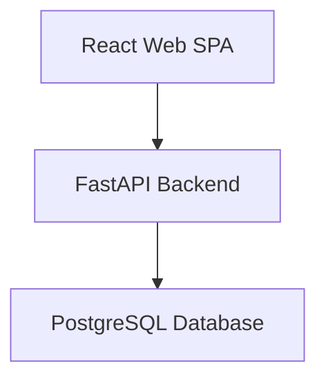
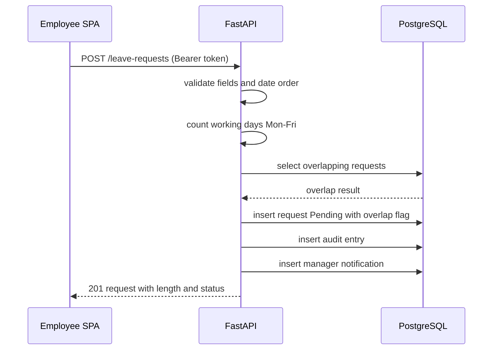
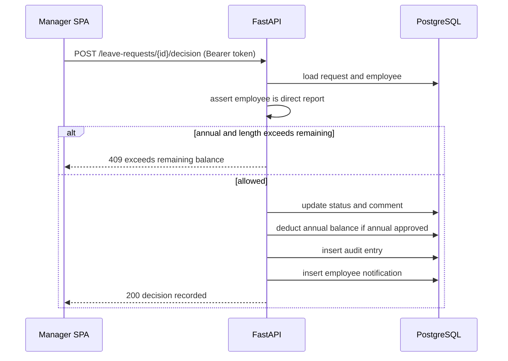
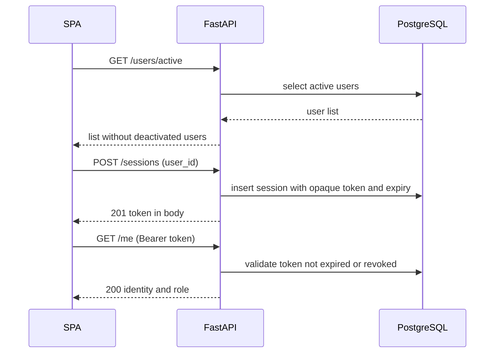
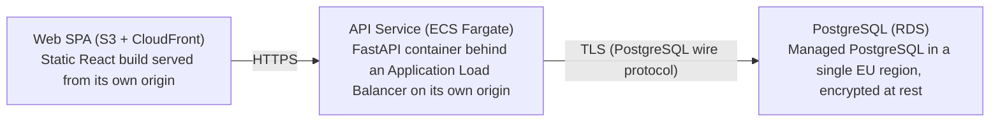

# Architecture

> Maintained by QuorQ AI SDLC. Text between `sdlc:auto` markers is regenerated; anything outside them is yours and is kept.

<!-- sdlc:auto:start narrative -->
## Overview

### ARCH-001 · approved · source: architecture:summary

Approved v1 architecture for a lightweight internal leave-management web app for a small insurance team, built on React 19 SPA + FastAPI 0.115 API + PostgreSQL 16, deployed to a single AWS EU region.

Version 1, status approved. Users sign in by picking their identity from a list (no passwords), creating a server-side session that returns an opaque bearer token the SPA sends on every API call. The FastAPI backend owns all business rules: whole-working-day (Mon-Fri) length calculation, the 20-day annual balance with yearly reset and no carryover, separate uncapped sick leave, overlap flagging, manager-only-on-direct-reports approval, blocking over-balance approvals, and an append-only audit trail. Role-based access and restricted visibility of sensitive sick-leave reasons meet GDPR-aligned handling required for an insurance context, with encryption at rest and in transit and all data pinned to one EU region.

**Related:** ARCH-COMP-WEB-SPA, ARCH-COMP-API-BACKEND, ARCH-COMP-DATABASE

### ARCH-COMP-WEB-SPA · approved · source: architecture:component:web_spa

React 19 single-page application delivering the entire user-facing UI, responsive for desktop and mobile.

Screens/areas: identity picker, leave request form, employee dashboard, manager approval queue, team calendar grid, HR admin area, audit log view, in-app notifications, getting-started docs. Stores the opaque session token and sends it as Authorization: Bearer on every API call.

### ARCH-COMP-API-BACKEND · approved · source: architecture:component:api_backend

Stateless FastAPI 0.115 backend that enforces all business rules and role-based access for the application.

Responsibilities: session creation/revocation; working-day length calculation; balance deduction and yearly reset; overlap flagging; manager-direct-report checks; over-balance approval blocking; sick-reason access control; append-only audit writes.

**Related:** ARCH-COMP-DATABASE

### ARCH-COMP-DATABASE · approved · source: architecture:component:database

PostgreSQL 16 durable relational store, encrypted at rest, with all data pinned to a single EU region.

Stores users and reporting lines, leave requests, per-year balances, opaque sessions, notifications, and the append-only audit log. Applies row-level and query-level restriction of sensitive sick-leave reasons to employee, manager and HR roles.

### ARCH-CP-SUBMIT-LEAVE-REQUEST · approved · source: architecture:critical_path:Submit a leave request

End-to-end flow for an employee submitting a leave request.

1. Employee submits start date, end date, type and reason. 2. Backend validates required fields and date order. 3. Backend computes whole working days (Mon-Fri). 4. Backend flags overlap against the employee's own pending/approved requests. 5. Request is stored with status Pending. 6. An audit entry is written. 7. A notification is raised for the manager.

**Related:** ARCH-COMP-WEB-SPA, ARCH-COMP-API-BACKEND, ARCH-COMP-DATABASE

### ARCH-CP-APPROVE-REJECT-BALANCE-GUARD · approved · source: architecture:critical_path:Approve or reject with balance guard

Manager decision flow on a direct report's pending request, including the over-balance approval guard.

1. Manager makes a decision on a pending request. 2. Backend verifies the request belongs to a direct report. 3. For annual leave, approval is blocked if working days exceed the employee's remaining balance. 4. On approval, the annual balance is deducted. 5. The manager's comment is recorded. 6. An audit entry is written. 7. The employee is notified of the decision.

**Related:** ARCH-COMP-WEB-SPA, ARCH-COMP-API-BACKEND, ARCH-COMP-DATABASE

### ARCH-CP-IDENTITY-SESSION · approved · source: architecture:critical_path:Identity sign-in and session end

Sign-in via identity selection (no passwords) and the session lifecycle through to termination.

1. User selects an active identity from a list. 2. Backend creates a session, returning an opaque bearer token in the response body. 3. The SPA stores the token and sends it as a bearer token on every subsequent call. 4. The session is revoked -- returning the user to the identity picker -- on explicit sign-out, on inactivity past the configured session lifetime, or on HR deactivation of that user.

**Related:** ARCH-COMP-WEB-SPA, ARCH-COMP-API-BACKEND

### ARCH-DATA-MODEL · approved · source: architecture:entities

Relational schema of six entities covering users, sessions, leave requests, balances, notifications and the audit log.

- users: id, full_name, role, manager_id, is_active, created_at.
- sessions: id, user_id, token, created_at, last_active_at, expires_at, revoked_at.
- leave_requests: id, employee_id, start_date, end_date, leave_type, reason, working_days, status, has_overlap, manager_comment, decided_by, decided_at, created_at.
- leave_balances: id, user_id, year, allocated_days, adjustment_days, adjustment_note, updated_at.
- notifications: id, user_id, type, leave_request_id, is_read, created_at.
- audit_log: id, actor_user_id, action_type, leave_request_id, detail, created_at.

**Related:** ARCH-COMP-DATABASE

### ARCH-API-IDENTITY · approved · source: architecture:endpoints

Identity-picker sign-in and session management endpoints.

- GET /users/active: list active users for the identity picker (deactivated users excluded).
- POST /sessions: create a session by selecting an identity; returns an opaque bearer token in the body.
- GET /me: return the acting identity, role and permissions; validates and refreshes session activity.
- DELETE /sessions/current: sign out, revoking the current session.

**Related:** ARCH-COMP-API-BACKEND, ARCH-CP-IDENTITY-SESSION

### ARCH-API-LEAVE-REQUESTS · approved · source: architecture:endpoints

Endpoints to submit, list and decide on leave requests.

- POST /leave-requests: submit a leave request; validates fields and date order, computes working days, flags overlap, stores Pending, audits and notifies the manager.
- GET /leave-requests/mine: list the acting employee's own requests with status, length and manager comment.
- GET /leave-requests/pending: manager view of pending requests from direct reports only, with employee, length, reason, remaining balance and overlap flag.
- POST /leave-requests/{id}/decision: approve or reject a direct report's request with a comment; blocks annual approval beyond remaining balance, deducts on approval, audits and notifies.

**Related:** ARCH-COMP-API-BACKEND, ARCH-CP-SUBMIT-LEAVE-REQUEST, ARCH-CP-APPROVE-REJECT-BALANCE-GUARD

### ARCH-API-BALANCES-CALENDAR · approved · source: architecture:endpoints

Endpoints for the employee's own annual balance and the team calendar.

- GET /balances/mine: return the acting employee's remaining annual balance for the current year.
- GET /calendar: team calendar of approved leave by day; shows who is on leave without exposing sick-leave reasons.

**Related:** ARCH-COMP-API-BACKEND

### ARCH-API-NOTIFICATIONS · approved · source: architecture:endpoints

In-app notification endpoints for pending items and decision updates.

- GET /notifications: in-app indicators for the acting user (pending items for managers, decision updates for employees).
- POST /notifications/{id}/read: mark an in-app notification as read.

**Related:** ARCH-COMP-API-BACKEND

### ARCH-API-ADMIN · approved · source: architecture:endpoints

HR/Admin endpoints for user management, balance adjustment, and audit log access.

- GET /admin/users: list all users with role, reporting line and active state.
- POST /admin/users: add a user with name and role.
- PATCH /admin/users/{id}: edit a user, set reporting line, or deactivate (deactivation revokes that user's sessions).
- PUT /admin/users/{id}/balance: set a new remaining annual balance with a note; writes an audit entry.
- GET /admin/audit-log: view append-only audit entries; denied to Employee and Manager roles.

**Related:** ARCH-COMP-API-BACKEND, ARCH-COMP-DATABASE

### ARCH-API-DOCS · approved · source: architecture:endpoints

Getting-started guidance endpoint.

- GET /docs/getting-started: role-appropriate getting-started guidance content.

**Related:** ARCH-COMP-API-BACKEND

### ARCH-DEPLOY-TOPOLOGY · approved · source: architecture:deployment_nodes

Three-node AWS deployment topology, all data and compute pinned to a single EU region.

- Web SPA: static React 19 build served via S3 + CloudFront, on its own origin.
- API Service: FastAPI 0.115 container on Python 3.12 (Uvicorn), running on ECS Fargate behind an Application Load Balancer, on its own origin.
- PostgreSQL: managed RDS PostgreSQL 16 in a single EU region, encrypted at rest.

**Related:** ARCH-COMP-WEB-SPA, ARCH-COMP-API-BACKEND, ARCH-COMP-DATABASE

### ARCH-TECH-FRONTEND · approved · source: architecture:technology_decisions:Frontend

Frontend stack decision: React 19, chosen over Vue and Svelte.

Delivers the role-driven, stateful screens (request form, approval queue, calendar grid, HR admin) as one responsive codebase for desktop and mobile browsers, and stores the opaque session token to send as a bearer header.

**Related:** ARCH-COMP-WEB-SPA

### ARCH-TECH-BACKEND · approved · source: architecture:technology_decisions:Backend

Backend stack decision: FastAPI 0.115, chosen over Flask and Django REST Framework.

Expresses the leave rules as a small set of typed endpoints -- working-day counting, balance deduction, overlap flagging, manager-only-on-reports, over-balance blocking and audit writes -- with Pydantic validation and automatic OpenAPI docs.

**Related:** ARCH-COMP-API-BACKEND

### ARCH-TECH-DATABASE · approved · source: architecture:technology_decisions:Database

Database decision: PostgreSQL 16, chosen over MySQL and SQLite.

Enforces the relational model (users, reporting lines, requests, per-year balances, append-only audit) with transactional correctness for balance adjustments, and restricts sensitive sick-leave reasons to authorised roles.

**Related:** ARCH-COMP-DATABASE

### ARCH-TECH-CLOUD · approved · source: architecture:technology_decisions:Cloud

Cloud platform decision: AWS, chosen over Azure and GCP.

Pins all personal and health data to one EU region with encryption at rest/in transit and IAM access controls, meeting GDPR-aligned handling while running a small footprint for tens of users.

**Related:** ARCH-DEPLOY-TOPOLOGY
<!-- sdlc:auto:end narrative -->

<!-- sdlc:auto:start building-blocks -->
## Building Block View

| ID | Name | Technology | Responsibility | Depends on |
|---|---|---|---|---|
| web_spa | React Web SPA | React 19 | Responsive desktop/mobile UI: identity picker, leave request form, employee dashboard, manager approval queue, team calendar grid, HR admin area, audit log view, in-app notifications and getting-started docs. Stores the opaque session token and sends it as Authorization: Bearer on every API call. | api_backend |
| api_backend | FastAPI Backend | FastAPI 0.115 | Stateless HTTP API enforcing all business rules and role-based access: session creation/revocation, working-day length, balance deduction and yearly reset, overlap flagging, manager-direct-report checks, over-balance approval blocking, sick-reason access control, and append-only audit writes. | database |
| database | PostgreSQL Database | PostgreSQL 16 | Durable, relational store for users and reporting lines, leave requests, per-year balances, opaque sessions, notifications, and the append-only audit log. Row-level and query-level restriction of sensitive sick-leave reasons to employee, manager and HR. Encrypted at rest in an EU region. | — |

<!-- sdlc:auto:end building-blocks -->

<!-- sdlc:auto:start runtime -->
## Runtime View

### Submit a leave request

Employee submits dates, type and reason. Backend validates required fields and date order, computes whole working days (Mon-Fri), flags overlap with the employee's pending/approved requests, stores the request as Pending, writes an audit entry and raises a manager notification.

- **Components:** web_spa, api_backend, database
- **Modules:** leave_requests, working_days, overlap, audit, notifications
- **Key functions:** create_leave_request(user_id, start_date, end_date, type, reason), count_working_days(start_date, end_date), detect_overlap(user_id, start_date, end_date), write_audit(actor_id, action_type, detail)

### Approve or reject with balance guard

Manager decides on a direct report's pending request. Backend verifies the request belongs to a direct report, and for annual leave blocks approval if working days exceed remaining balance; on approval it deducts the annual balance, records the comment, writes audit and notifies the employee.

- **Components:** web_spa, api_backend, database
- **Modules:** approvals, balances, authz, audit, notifications
- **Key functions:** decide_request(manager_id, request_id, decision, comment), assert_direct_report(manager_id, employee_id), remaining_annual_balance(user_id, year), deduct_annual_balance(user_id, year, days)

### Identity sign-in and session end

User selects an active identity. Backend creates a session with an opaque token returned in the body; the SPA stores it and sends it as a bearer token. Sign-out, inactivity past the configured lifetime, or HR deactivation revokes the session so the user returns to the identity picker.

- **Components:** web_spa, api_backend, database
- **Modules:** sessions, users, authz
- **Key functions:** list_active_users(), create_session(user_id), validate_session(token), revoke_session(token), revoke_sessions_for_user(user_id)

<!-- sdlc:auto:end runtime -->

<!-- sdlc:auto:start deployment-view -->
## Deployment View

| Name | Service | Runtime | Scaling | Environment |
|---|---|---|---|---|
| Web SPA (S3 + CloudFront) | Static React build served from its own origin | React 19 static assets | CDN edge cache, single small distribution | dev |
| API Service (ECS Fargate) | FastAPI container behind an Application Load Balancer on its own origin | FastAPI 0.115 on Python 3.12 (Uvicorn) | 1-2 small tasks, sized for tens of users | dev |
| PostgreSQL (RDS) | Managed PostgreSQL in a single EU region, encrypted at rest | PostgreSQL 16 | Single small instance, automated backups | dev |

| Source | Target | Protocol |
|---|---|---|
| Web SPA (S3 + CloudFront) | API Service (ECS Fargate) | HTTPS |
| API Service (ECS Fargate) | PostgreSQL (RDS) | TLS (PostgreSQL wire protocol) |

<!-- sdlc:auto:end deployment-view -->

<!-- sdlc:auto:start decisions -->
## Architecture Decisions

| Layer | Choice | ADR |
|---|---|---|
| Frontend | React 19 | [ADR-0001](adr/frontend.md) |
| Backend | FastAPI 0.115 | [ADR-0002](adr/backend.md) |
| Database | PostgreSQL 16 | [ADR-0003](adr/database.md) |
| Cloud | AWS | [ADR-0004](adr/cloud.md) |
<!-- sdlc:auto:end decisions -->

<!-- sdlc:auto:start links -->
## Related Documents

- [Data Model](data-model.md)
- [API Specification](api/openapi.yaml)
- [Architecture Decision Records](adr/README.md)
<!-- sdlc:auto:end links -->
