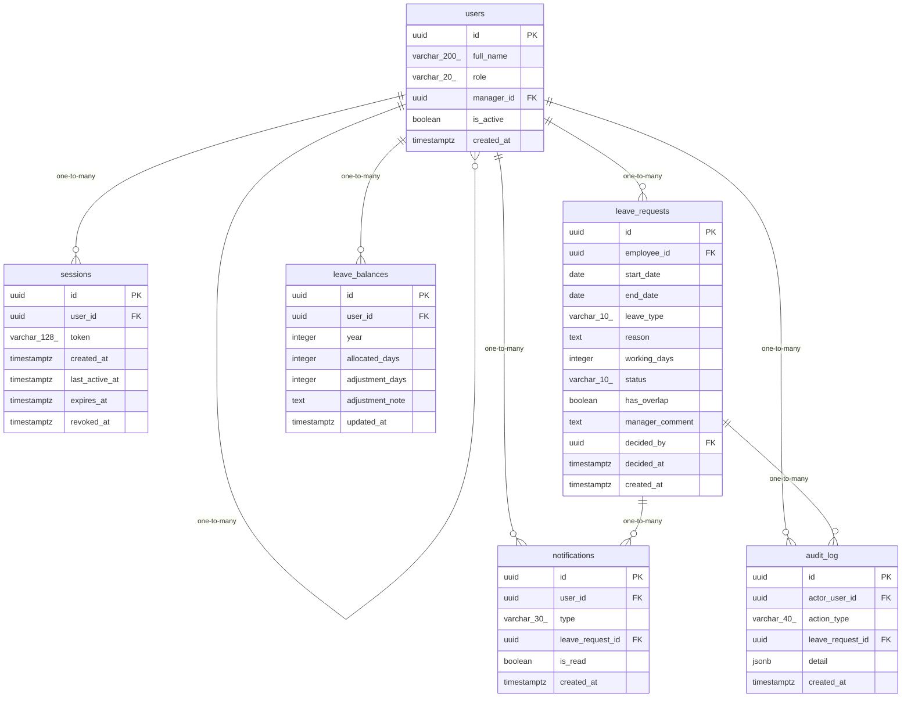

# Data Model

<!-- sdlc:auto:start entities -->
### users

| Field | Type | PK | FK | Nullable |
|---|---|---|---|---|
| id | uuid | True | — | False |
| full_name | varchar(200) | False | — | False |
| role | varchar(20) | False | — | False |
| manager_id | uuid | False | users.id | True |
| is_active | boolean | False | — | False |
| created_at | timestamptz | False | — | False |

### sessions

| Field | Type | PK | FK | Nullable |
|---|---|---|---|---|
| id | uuid | True | — | False |
| user_id | uuid | False | users.id | False |
| token | varchar(128) | False | — | False |
| created_at | timestamptz | False | — | False |
| last_active_at | timestamptz | False | — | False |
| expires_at | timestamptz | False | — | False |
| revoked_at | timestamptz | False | — | True |

### leave_requests

| Field | Type | PK | FK | Nullable |
|---|---|---|---|---|
| id | uuid | True | — | False |
| employee_id | uuid | False | users.id | False |
| start_date | date | False | — | False |
| end_date | date | False | — | False |
| leave_type | varchar(10) | False | — | False |
| reason | text | False | — | False |
| working_days | integer | False | — | False |
| status | varchar(10) | False | — | False |
| has_overlap | boolean | False | — | False |
| manager_comment | text | False | — | True |
| decided_by | uuid | False | users.id | True |
| decided_at | timestamptz | False | — | True |
| created_at | timestamptz | False | — | False |

### leave_balances

| Field | Type | PK | FK | Nullable |
|---|---|---|---|---|
| id | uuid | True | — | False |
| user_id | uuid | False | users.id | False |
| year | integer | False | — | False |
| allocated_days | integer | False | — | False |
| adjustment_days | integer | False | — | False |
| adjustment_note | text | False | — | True |
| updated_at | timestamptz | False | — | False |

### notifications

| Field | Type | PK | FK | Nullable |
|---|---|---|---|---|
| id | uuid | True | — | False |
| user_id | uuid | False | users.id | False |
| type | varchar(30) | False | — | False |
| leave_request_id | uuid | False | leave_requests.id | True |
| is_read | boolean | False | — | False |
| created_at | timestamptz | False | — | False |

### audit_log

| Field | Type | PK | FK | Nullable |
|---|---|---|---|---|
| id | uuid | True | — | False |
| actor_user_id | uuid | False | users.id | False |
| action_type | varchar(40) | False | — | False |
| leave_request_id | uuid | False | leave_requests.id | True |
| detail | jsonb | False | — | False |
| created_at | timestamptz | False | — | False |
<!-- sdlc:auto:end entities -->

<!-- sdlc:auto:start relationships -->
| Source | Target | Type |
|---|---|---|
| users | users | one-to-many |
| users | sessions | one-to-many |
| users | leave_requests | one-to-many |
| users | leave_balances | one-to-many |
| users | notifications | one-to-many |
| users | audit_log | one-to-many |
| leave_requests | notifications | one-to-many |
| leave_requests | audit_log | one-to-many |
<!-- sdlc:auto:end relationships -->

<!-- sdlc:auto:start er-diagram -->

<!-- sdlc:auto:end er-diagram -->
