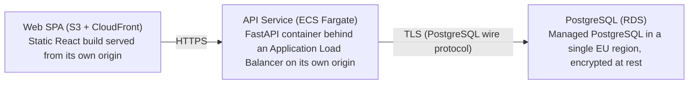

# Deployment Guide

> Maintained by QuorQ AI SDLC. Text between `sdlc:auto` markers is regenerated; anything outside them is yours and is kept.

<!-- sdlc:auto:start how-it-deploys -->
Pushes to `main` run `.github/workflows/deploy.yml`, which builds the API image (if there is a backend) and deploys the SPA to AWS Amplify. Commits touching only `docs/sdlc/**` don't deploy. Deployments can also be started from the platform's Deployment tab.
<!-- sdlc:auto:end how-it-deploys -->

<!-- sdlc:auto:start environments -->
| Name | Service | Runtime | Scaling | Environment |
|---|---|---|---|---|
| Web SPA (S3 + CloudFront) | Static React build served from its own origin | React 19 static assets | CDN edge cache, single small distribution | dev |
| API Service (ECS Fargate) | FastAPI container behind an Application Load Balancer on its own origin | FastAPI 0.115 on Python 3.12 (Uvicorn) | 1-2 small tasks, sized for tens of users | dev |
| PostgreSQL (RDS) | Managed PostgreSQL in a single EU region, encrypted at rest | PostgreSQL 16 | Single small instance, automated backups | dev |
<!-- sdlc:auto:end environments -->

<!-- sdlc:auto:start live -->
**Frontend URL:** https://p2719c341de04.d3j61xaup4zgrx.amplifyapp.com

**Backend URL:** https://32-190-6-179.sslip.io/apps/2719c341de04/

**Database:** PostgreSQL · app

**Version:** 17ff63b0a6a2

**Commit:** `17ff63b`

**Finished:** 2026-11-19
<!-- sdlc:auto:end live -->

<!-- sdlc:auto:start topology -->

<!-- sdlc:auto:end topology -->
